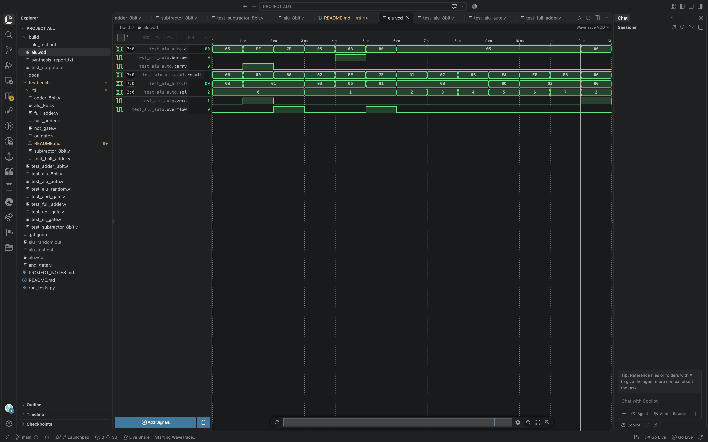

## 8-Bit Arithmetic Logic Unit (ALU)

An 8-bit Arithmetic Logic Unit designed using Verilog HDL.

The ALU accepts two 8-bit inputs, A and B, and performs
arithmetic and bitwise logical operations based on a 3-bit
selection input.

## Operations

| Select | Operation   | Description             |
| ------ | ----------- | ----------------------- |
| 000    | Addition    | Adds A and B            |
| 001    | Subtraction | Subtracts B from A      |
| 010    | AND         | Bitwise AND             |
| 011    | OR          | Bitwise OR              |
| 100    | XOR         | Bitwise XOR             |
| 101    | NOT         | Bitwise complement of A |
| 110    | NAND        | Bitwise NAND            |
| 111    | NOR         | Bitwise NOR             |

## Status Flags

- Carry: Indicates carry out during addition.
- Borrow: Indicates unsigned subtraction when A is less than B.
- Zero: Indicates that the result is zero.
- Overflow: Indicates signed 8-bit arithmetic overflow for addition or subtraction.

## Tools Used

- Verilog HDL
- EDA Playground for online simulation
- Visual Studio Code for editing
- Git and GitHub for version control

## Verification

The automated testbench checks expected results and status flags.

Test scenarios include:

- Addition: 5 + 3 = 8
- Carry: 255 + 1 produces an 8-bit result of 0 with carry set
- Signed addition overflow: 127 + 1
- Subtraction: 5 - 3 = 2
- Borrow: 3 - 5 produces an 8-bit result of 254
- Signed subtraction overflow: -128 - 1
- AND, OR, XOR, NOT, NAND and NOR operations
- Zero flag when the result is zero

Run the design and testbench on EDA Playground using an
appropriate Verilog simulator. The local testbench includes
automatic PASS/FAIL checks.

## Project Status

Educational RTL design and simulation project.
No physical hardware implementation has been completed.

## Simulation Waveform

The 8-bit ALU was simulated on EDA Playground.
The waveform below shows the simulation signals.

